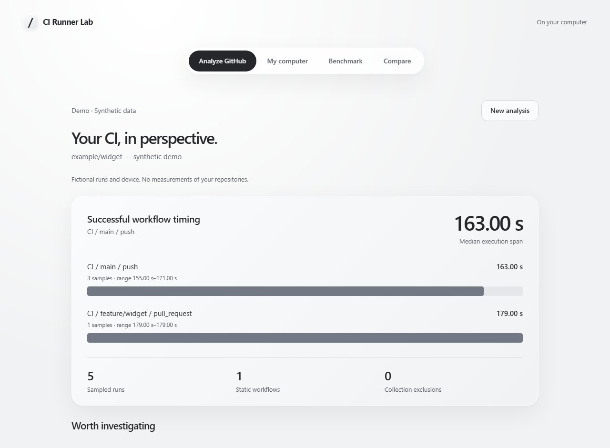

# CI Runner Lab

Find slow GitHub Actions workflows, inspect your computer, and measure trusted npm scripts in a local browser app.



*Demo — synthetic data, not measurements of your repository.*

## Quick start

Use a patched **Node.js 24 LTS** release and npm. Node **22.13+ LTS** is also supported.
CI tests Node 24 on Windows, macOS and Linux, and Node 22 on Linux.

```sh
git clone https://github.com/kokoc30/ci-runner-lab.git
cd ci-runner-lab
npm ci
npm start
```

The app opens in your browser. Select **Try demo** to explore without a login,
then enter a GitHub `owner/repository` to analyze real runs.
Only GitHub audits need the separately installed [GitHub CLI](https://cli.github.com/):
run `gh auth login` once in your terminal. No token is pasted into the app.

The server listens only on `127.0.0.1`, on an available port printed in the terminal.
Keep the terminal open; press **Ctrl+C** to stop it. In a noninteractive shell,
`npm start` prints help rather than starting a persistent server. Use
`npm start -- ui --no-open` when you explicitly want a local server without opening a browser.

## What it does

- **Analyze GitHub:** inspect workflows and recent runs, with optional branch, event and workflow filters. Local YAML inspection is under **More**.
- **My computer:** see CPU, memory and conservative worker suggestions. Observations and estimates stay separate.
- **Benchmark:** load scripts from a trusted local project, review the command and limits, then explicitly allow each run. Stop a running task from the browser.
- **Compare:** choose reports from the current session or load saved JSON files. Workload, revision and environment warnings accompany the result.

The browser uses your system's light/dark appearance and reduced-motion/transparency settings.
Technical evidence lives in expandable details and the complete report.
Paste a local directory path for local inspection or benchmarking; there is no filesystem browser.
Scripts or lifecycle hooks over 1,000 characters require the CLI so the browser never shows an incomplete approval preview.
The most recent 30 reports are available in the current session. Restarting clears this list, not saved files.

## CLI for advanced users

All explicit CLI commands still work. The original guided terminal menu is `npm run cli`.

```sh
npm start -- demo --no-open
npm start -- doctor --no-open
npm start -- audit --repo owner/repository --runs 10 --no-open
npm start -- audit --path "my-project" --no-open
npm start -- bench --path "my-project" --script test:ci --allow-exec --no-open
npm start -- compare "before/report.json" "after/report.json" --no-open
```

Use `npm start -- --help` for limits, filters and optional cost inputs.
`--out <directory>` changes the CLI output folder; `--open` opens a finished report.
For clean machine-readable output, use `node src/cli.js demo --json --no-open`.

## Reports and boundaries

Each task writes `report.html`, `report.md` and schema-v1 `report.json` into a unique
folder under `.ci-runner-lab/reports/`. The browser links to the complete report and
JSON/Markdown downloads. HTML reports remain self-contained, JavaScript-free,
printable and usable offline. Review private repository metadata before sharing.

Audits are read-only and never execute target code. Benchmarks execute npm scripts
and lifecycle hooks with your normal permissions: **they are not sandboxed**.
They can change files, access credentials on disk, use the network and spawn workers.
Known GitHub/npm auth environment variables are removed. Timeouts, output caps and
cancellation terminate owned process trees; detached/adversarial processes are outside that guarantee.

Elapsed time is measured; CPU utilization, process-tree memory and power are not.
Successful-run timings exclude failed and incomplete runs. Execution span differs
from aggregate job time. Only the latest run attempt is sampled. Cost scenarios
are estimates with explicit assumptions, not bills or promised savings.
Worker suggestions are heuristics, not resource limits. Static inspection leaves
expressions and reusable workflow internals unresolved. GitHub Enterprise is not supported.

There is no telemetry, account system, database, automatic workflow rewriting or
runner installation. Keep the privileged app local; never reverse-proxy or publicly
host it. Host/Origin checks and a per-session token protect browser requests.
The optional public demonstration is only a static synthetic report, with no execution API.

## Development

```sh
npm ci
npm run check
npx --no-install playwright install chromium
npm run test:ui
```

Checks cover calculations, CLI behavior, server boundaries, consent, cancellation,
report escaping, real browser flows and responsive light/dark layouts. Browser
screenshots are written to `.ci-runner-lab/qa/`. Automated browser coverage is Chromium.
See [AGENTS.md](AGENTS.md) for the concise design and engineering standards.

Bug reports and focused contributions are welcome through [issues](https://github.com/kokoc30/ci-runner-lab/issues)
and pull requests. Include reproduction steps and run the checks above.

[MIT license](LICENSE).
